# 🏆 ByteCart — Judge & Evaluator Guide

> **Next-Gen In-Store Scan & Go, Smart Cart & Loss Prevention Platform**  
> *A friction-free retail shopping experience eliminating checkout lines while actively protecting store inventory.*

---

## 📌 Executive Summary (The 30-Second Elevator Pitch)

Traditional supermarket checkout is broken: **long queues lead to abandoned purchases**, while traditional self-checkout kiosks suffer from **rampant shrinkage (theft/missed scans)** and high hardware costs.

**ByteCart solves both sides of the retail equation:**
1. **For Shoppers**: Scan product barcodes shelf-side on their smartphone, monitor their budget with a real-time progress ring, navigate aisles using an interactive 2D store map, and complete self-checkout in seconds.
2. **For Retailers**: Built-in automated **Loss Prevention Reconciliation** that detects un-scanned items before checkout clearance, paired with a live **Staff Operations Console** for real-time inventory management, expiry tracking, and audit logging.

---

## ⚡ Quick Evaluation Setup (Test in Under 60 Seconds)

### Running the Web Platform Locally:
If the server is running, open:
👉 **[http://localhost:3000/](http://localhost:(port)/)**

To launch or restart the server at any time:
```bash
cd "ByteCart website"
node serve.js
```
*(Or run `python serve_v2.py`, or open `bytecart_v2.html` directly in any browser).*

### Demo Credentials:
- **Shopper View**: No authentication required.
- **Staff Console**: Navigate to `#staff` (or click **Staff** in the top navigation).  
  - **Staff ID**: `admin` (or `staff101`)  
  - **Password**: `admin` (or `staff123`)

---

## 🧪 Interactive Evaluation Walkthrough (5 Test Scenarios)

Judges can test the full capabilities of ByteCart following these 5 quick scenarios:

### 1. In-Aisle Scan & Go with Budget Tracker
1. Go to **Shop** (`#shop`).
2. Click **Scan product** in the navigation bar to launch the barcode scanner (supports camera feed or test simulated scans).
3. Alternatively, click **Add** on any product (e.g. *Fresh Bananas* or *Tomatoes 1kg*).
4. **Observe**:
   - The **Smart Cart** drawer tracks spending in real-time against a predefined ₹1,500 budget.
   - The visual circular budget ring dynamically reflects percentage utilized.
   - Item counts, GST, and savings versus MRP update instantly.

### 2. Smart Cost-Saving Recommendations
1. Add an item with available cheaper alternatives (such as *Tomatoes 1kg* at ₹40).
2. Look at the **Recommendations** card beneath the cart.
3. **Observe**: The rule-based engine suggests *"Save ₹5 with Local Tomatoes 1kg"*.
4. Click **Replace item** to swap products in 1 click and automatically update the cart.

### 3. Loss Prevention & Cart Reconciliation (Key Innovation)
1. In the **Shop** view, simulate an un-scanned item by clicking **Add** without scanning.
2. Navigate to **Checkout** (`#checkout`).
3. **Observe**:
   - The checkout detects a discrepancy: `Verification required. 1 item(s) were added without a scan.`
   - Payment confirmation button is **disabled/locked**.
4. Test reconciliation:
   - Click **Simulate re-scan** to resolve the flag and unlock payment.
   - Or click **Request staff review** to escalate the flag to the Staff queue.

### 4. Interactive Supermarket Navigation Map
1. Click **Store map** in the navigation bar (`#map`).
2. In the search box *"Search a product to highlight its aisle"*, type **Coffee** or **Milk**.
3. **Observe**: The floorplan highlights Aisle 2 (Dairy) or Aisle 6 (Beverages) with directions on where to locate the product in the store.

### 5. Staff Operations & Inventory Management
1. Click **Staff** (`#staff`) and log in with `admin` / `admin`.
2. **Observe**:
   - **Executive KPIs**: Real-time counter of low/out-of-stock items, products expiring in ≤ 7 days, open discrepancy flags, and total store units.
   - **Products Tab**: Live catalog with editable price and stock fields.
   - **Alerts Tab**: Immediate notifications for restock requests and near-expiry items.
   - **Verification Tab**: Review customer flag alerts and approve or reject checkout clearance.
   - **Audit Tab**: Timestamped security ledger tracking every scan, manual entry, and transaction.

---

## 🎯 Alignment with Judging Criteria

| Criterion | How ByteCart Delivers |
| :--- | :--- |
| **💡 Innovation & Originality** | Combines mobile scan-and-go with hardware-light **loss prevention reconciliation** and real-time **shopper budget management**, bridging customer convenience with retailer security. |
| **🎨 UI/UX & Polish** | Built with custom design tokens, Space Grotesk & Inter typography, animated SVG illustrations, dark navigation accents, and responsive mobile layout. |
| **⚙️ Technical Architecture** | Zero bulky framework dependencies. High-performance, lightweight vanilla ES6+ reactive state engine running identically on the web and within native Android via Capacitor. |
| **📈 Market Viability & Impact** | Directly addresses retail's two largest pain points: checkout line abandonment (costing retailers up to 10% in lost sales) and retail theft/shrinkage (a $100B+ global challenge). |
| **📱 Completeness** | End-to-end working implementation: barcode scanning, shelf-side budgeting, floor mapping, digital checkout, tamper-evident receipts, and backend staff administration. |

---

## 🏛️ System Architecture & Workflow

### End-to-End Workflow Flowchart

```mermaid
flowchart TD
    Start(["Shopper Enters Store"]) --> LaunchApp["Launch ByteCart (Web / Android)"]
    LaunchApp --> SetBudget["Set Shopping Budget (e.g. ₹1,500)"]
    SetBudget --> MapSearch{"Need Item Location?"}
    
    MapSearch -- "Yes" --> StoreMap["Search Store Map & Pinpoint Aisle (A1 - A6)"]
    StoreMap --> ScanAisle["Shelf-Side Product Selection"]
    MapSearch -- "No" --> ScanAisle
    
    ScanAisle --> BarcodeScan["Scan Barcode via Camera / Barcode Input"]
    BarcodeScan --> StockExpCheck["Fetch Live Price, Stock & Expiry Countdown"]
    StockExpCheck --> BudgetCalc["Update Real-Time Budget Gauge & Taxes"]
    
    BudgetCalc --> RecEngine{"Cost-Saving Alternative Found?"}
    RecEngine -- "Yes" --> ShowRec["Display Rule-Based Savings Suggestion"]
    ShowRec --> SwapChoice{"Swap Item?"}
    SwapChoice -- "Yes" --> SwapItem["1-Click Swap for Cheaper / Fresher Alternative"]
    SwapChoice -- "No" --> AddItem["Add Original Item to Smart Cart"]
    RecEngine -- "No" --> AddItem
    SwapItem --> AddItem
    
    AddItem --> MoreShopping{"Continue Shopping?"}
    MoreShopping -- "Yes" --> ScanAisle
    MoreShopping -- "No" --> Checkout["Proceed to Scan & Go Checkout"]
    
    Checkout --> SensorCheck{"Loss Prevention Check<br/>(Scanned Log == Bag Contents?)"}
    SensorCheck -- "Discrepancy (Unscanned Item)" --> FlagIssue["Flag Cart Discrepancy & Lock Checkout"]
    FlagIssue --> Resolution{"Resolution Path"}
    Resolution -- "Self-Service" --> RescanItem["Simulate Re-scan of Flagged Item"]
    Resolution -- "Escalation" --> StaffReview["Queue Alert to Staff Console"]
    StaffReview --> StaffAction{"Staff Decision"}
    StaffAction -- "Approved" --> UnlockCheckout["Clear Flag & Unlock Payment"]
    StaffAction -- "Rejected" --> RescanItem
    RescanItem --> SensorCheck
    
    SensorCheck -- "Passed (All Items Reconciled)" --> UnlockCheckout
    UnlockCheckout --> Payment["Select Payment (UPI / Card / Net Banking / Wallet)"]
    Payment --> ProcessPay["Process Payment (Simulated Instant Clear)"]
    ProcessPay --> Receipt["Generate Tamper-Evident Digital Receipt"]
    Receipt --> Exit(["Pass Exit Clearance & Complete Shopping"])
```


### Architectural Layering

```text
┌────────────────────────────────────────────────────────┐
│                      ByteCart                          │
├──────────────────────────┬─────────────────────────────┤
│   Shopper Client         │   Store Operations Console  │
│   • Barcode Scanner      │   • Real-Time Store KPIs    │
│   • Smart Cart & Budget  │   • Live Inventory Editor   │
│   • Loss Prevention Check│   • Flag Approval Queue     │
│   • Interactive Map      │   • Tamper-Evident Audit    │
├──────────────────────────┴─────────────────────────────┤
│              Shared Application Core                   │
│   • Reactive State Store (sm1 / fresh)                 │
│   • Rule-Based Recommendation Engine                   │
│   • Local Storage Persistence & Session Security       │
├──────────────────────────┬─────────────────────────────┤
│   Web Distribution       │   Android Mobile App        │
│   • Node.js serve.js     │   • Capacitor Bridge        │
│   • Python serve_v2.py   │   • Native Gradle Build     │
└──────────────────────────┴─────────────────────────────┘
```

---

## 👥 Project Information

- **Platform Support**: Web (Desktop & Mobile Browser) & Android Native (Capacitor)
- **Primary Source Code**:
  - Storefront & Engine: [`ByteCart website/bytecart_v2.js`](file:///c:/Users/ojasl/OneDrive/Documents/My%20codes/ByteCart/ByteCart%20website/bytecart_v2.js)
  - UI Markup: [`ByteCart website/bytecart_v2.html`](file:///c:/Users/ojasl/OneDrive/Documents/My%20codes/ByteCart/ByteCart%20website/bytecart_v2.html)
  - Design Tokens: [`ByteCart website/bytecart_v2.css`](file:///c:/Users/ojasl/OneDrive/Documents/My%20codes/ByteCart/ByteCart%20website/bytecart_v2.css)
  - React Component Version: [`ByteCart website/Bytecart_v2.jsx`](file:///c:/Users/ojasl/OneDrive/Documents/My%20codes/ByteCart/ByteCart%20website/Bytecart_v2.jsx)
  - Android Capacitor App: [`ByteCart android application/`](file:///c:/Users/ojasl/OneDrive/Documents/My%20codes/ByteCart/ByteCart%20android%20application/)
