# ByteCart

<p align="center">
  
</p>

<p align="center">
  <strong>Next-Gen In-Store Scan & Go, Smart Cart & Loss Prevention Platform</strong>
</p>

<p align="center">
  
  
  
  
</p>

<p align="center">
  👉 <strong><a href="JUDGES.md">Read the Judge & Evaluator Guide (JUDGES.md)</a></strong>
</p>

---

## 📖 Overview

**ByteCart** is an end-to-end retail shopping platform engineered to eliminate checkout lines and elevate the in-store customer experience. By combining a rich desktop web storefront with a companion Android mobile application built with Capacitor, ByteCart empowers shoppers to scan items in the aisle, monitor their budget in real-time, navigate store layouts, and complete self-checkout in seconds—backed by automated loss prevention reconciliation and an operations console for store staff.

---

## ✨ Key Features

- **📱 Mobile Scan & Go**: Scan product barcodes directly on the aisle shelf to instantly look up pricing, nutritional info, stock levels, and expiry countdowns.
- **🛒 Smart Cart & Live Budgeting**: Dynamic visual budget progress tracker that alerts shoppers as they approach their spending limit and suggests rule-based cost-saving alternatives.
- **🗺️ Interactive Store Map**: Search for any product or category to visually pinpoint its exact aisle and get turn-by-turn directions.
- **🛡️ Loss Prevention & Cart Reconciliation**: Built-in verification mechanism that reconciles scanned items against physical cart contents before generating a checkout clearance code.
- **💳 Simulated Digital Checkout**: Frictionless payment flow supporting simulated UPI, Cards, Net Banking, and Wallets with instantly generated tamper-evident digital receipts.
- **👔 Store Staff & Operations Dashboard**: Dedicated staff view with real-time discrepancy alerts, low-stock notifications, expiry tracking, and live inventory editing.

---

## 🔄 System Flowcharts

### 1. Shopper End-to-End Scan & Go Journey
This flowchart illustrates the customer's in-store experience from entering the supermarket, navigating aisles, scanning items with dynamic budget tracking, through loss prevention reconciliation and instant digital checkout.

```mermaid
flowchart TD
    Start(["Shopper Enters Store"]) --> LaunchApp["Launch ByteCart (Web / Android App)"]
    LaunchApp --> SetBudget["Set Shopping Budget (e.g. ₹1,500)"]
    SetBudget --> MapSearch{"Need Item Location?"}
    
    MapSearch -- "Yes" --> StoreMap["Search Store Map & Pinpoint Aisle (A1 - A6)"]
    StoreMap --> ScanAisle["Shelf-Side Product Selection"]
    MapSearch -- "No" --> ScanAisle
    
    ScanAisle --> BarcodeScan["Scan Barcode via Camera / Barcode Input"]
    BarcodeScan --> StockExpCheck["Fetch Live Price, Stock & Expiry Countdown"]
    StockExpCheck --> BudgetCalc["Update Real-Time Budget Gauge & Taxes"]
    
    BudgetCalc --> RecEngine{"Cost-Saving Alternative Found?"}
    RecEngine -- "Yes" --> ShowRec["Display Rule-Based Savings Suggestion"]
    ShowRec --> SwapChoice{"Swap Item?"}
    SwapChoice -- "Yes" --> SwapItem["1-Click Swap for Cheaper / Fresher Alternative"]
    SwapChoice -- "No" --> AddItem["Add Original Item to Smart Cart"]
    RecEngine -- "No" --> AddItem
    SwapItem --> AddItem
    
    AddItem --> MoreShopping{"Continue Shopping?"}
    MoreShopping -- "Yes" --> ScanAisle
    MoreShopping -- "No" --> Checkout["Proceed to Scan & Go Checkout"]
    
    Checkout --> SensorCheck{"Loss Prevention Check<br/>(Scanned Log == Bag Contents?)"}
    SensorCheck -- "Discrepancy (Unscanned Item)" --> FlagIssue["Flag Cart Discrepancy & Lock Checkout"]
    FlagIssue --> Resolution{"Resolution Path"}
    Resolution -- "Self-Service" --> RescanItem["Simulate Re-scan of Flagged Item"]
    Resolution -- "Escalation" --> StaffReview["Queue Alert to Staff Console"]
    StaffReview --> StaffAction{"Staff Decision"}
    StaffAction -- "Approved" --> UnlockCheckout["Clear Flag & Unlock Payment"]
    StaffAction -- "Rejected" --> RescanItem
    RescanItem --> SensorCheck
    
    SensorCheck -- "Passed (All Items Reconciled)" --> UnlockCheckout
    UnlockCheckout --> Payment["Select Payment (UPI / Card / Net Banking / Wallet)"]
    Payment --> ProcessPay["Process Payment (Simulated Instant Clear)"]
    ProcessPay --> Receipt["Generate Tamper-Evident Digital Receipt"]
    Receipt --> Exit(["Pass Exit Clearance & Complete Shopping"])
```

### 2. Store Staff & Loss Prevention Operations Flow
This diagram details the real-time operational loop managed through the Staff Console.

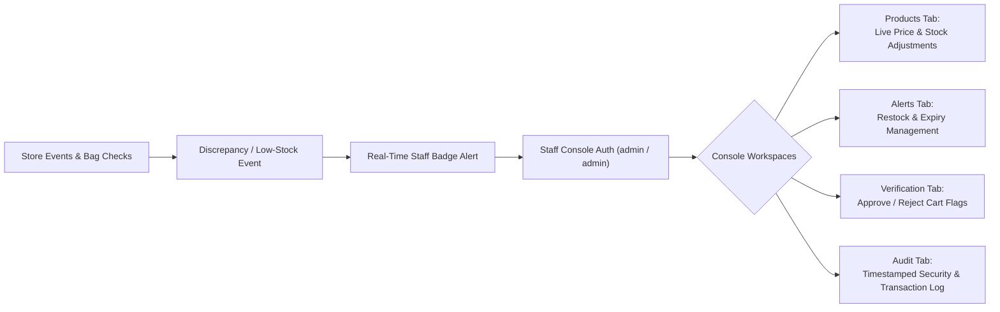

---

## 🖥️ Web Storefront & Staff Console

The ByteCart website offers an interactive storefront experience with real-time catalog browsing, store floorplan navigation, checkout simulation, and a dedicated staff operations suite.

### 1. Home / Landing Page
The storefront welcome page features an interactive tutorial, quick actions, and an animated live cart preview.

<p align="center">
  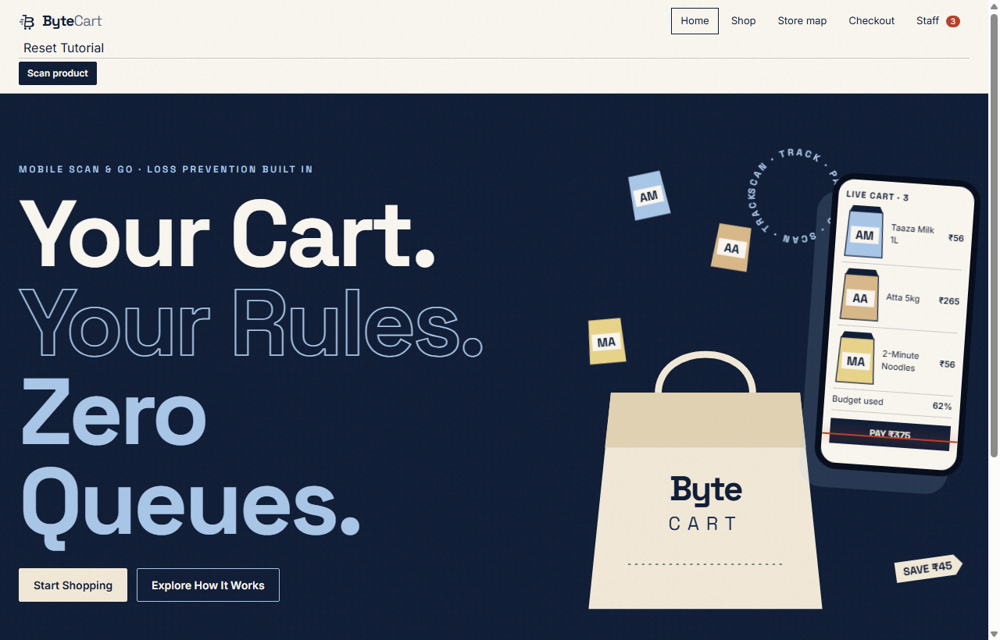
</p>

---

### 2. Shop & Catalog with Smart Cart
Browse products sorted by category and aisle, check live stock levels and expiry countdowns, and track your budget in the real-time smart cart drawer with instant cost-saving substitution recommendations.

<p align="center">
  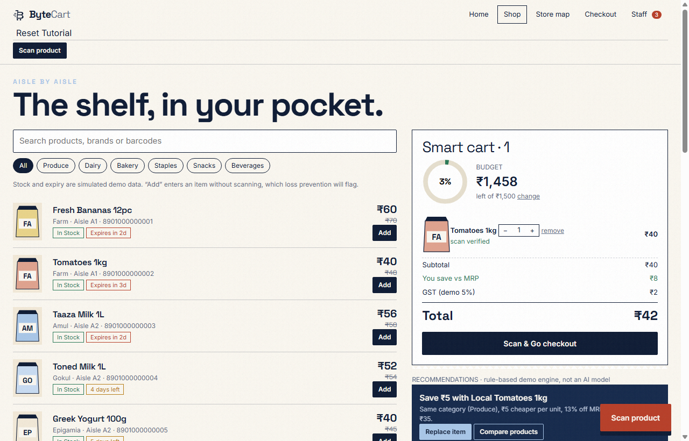
</p>

---

### 3. Interactive Store Map
An overhead 2D schematic of the supermarket layout (Aisles A1 to A6, Chilled Wall, Entry, and Checkout lanes) with instant search-to-highlight routing.

<p align="center">
  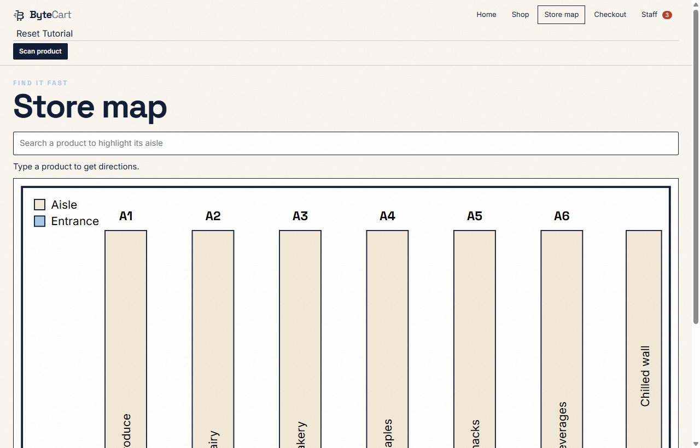
</p>

---

### 4. Scan & Go Checkout
Two-step self-checkout featuring simulated sensor cart verification to prevent loss, followed by flexible payment methods (UPI, Card, Net Banking, Wallet) and order cost reconciliation.

<p align="center">
  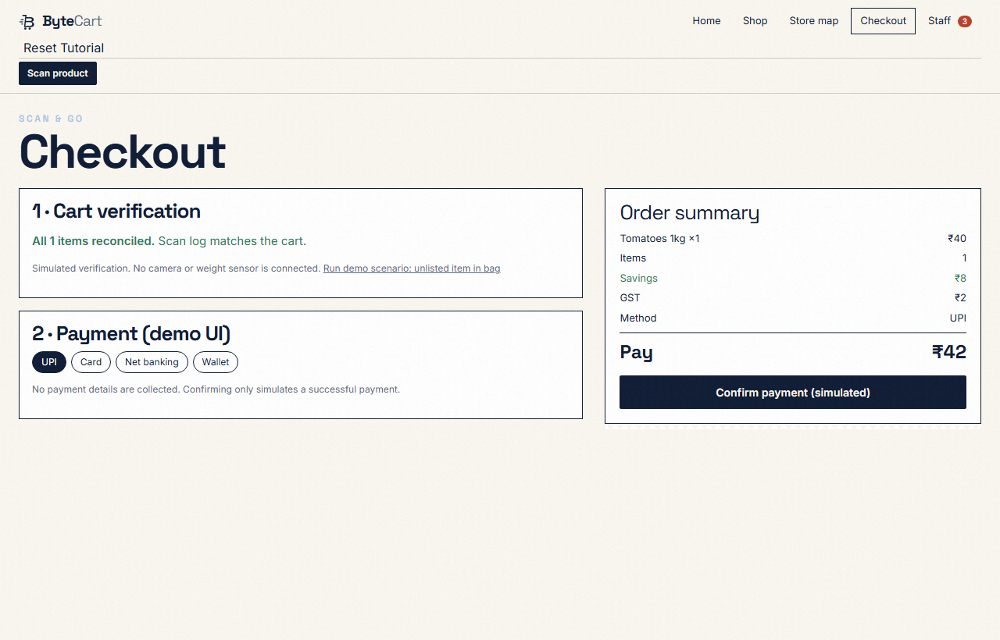
</p>

---

### 5. Staff Console & Inventory Management
A powerful internal dashboard for supermarket staff and store managers. Includes real-time KPI metrics (Low/out of stock counts, items expiring in ≤ 7 days, open discrepancy flags, total stock units) alongside tabs for inventory price/stock editing, alert resolution, cart verification queue, audit logs, and sales tracking.

<p align="center">
  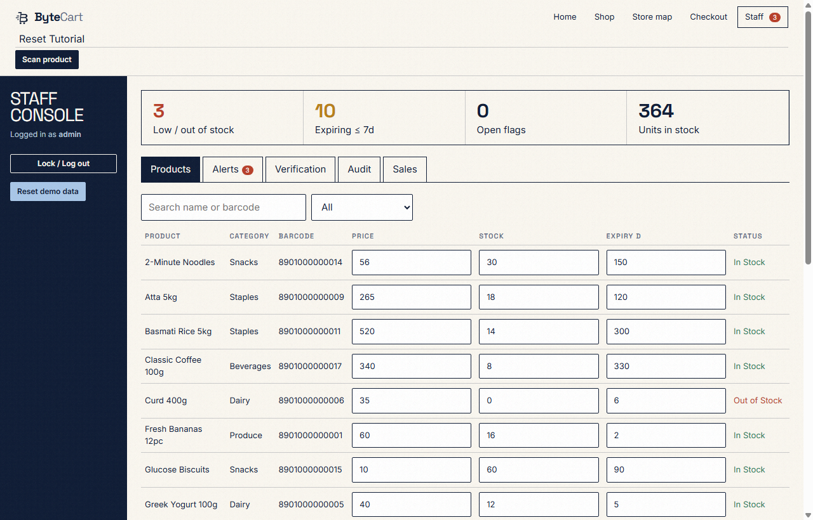
</p>

---

## 📱 Android Mobile Application

The mobile application is packaged using Capacitor, delivering a native Android experience optimized for single-handed use inside the store.

<p align="center">
  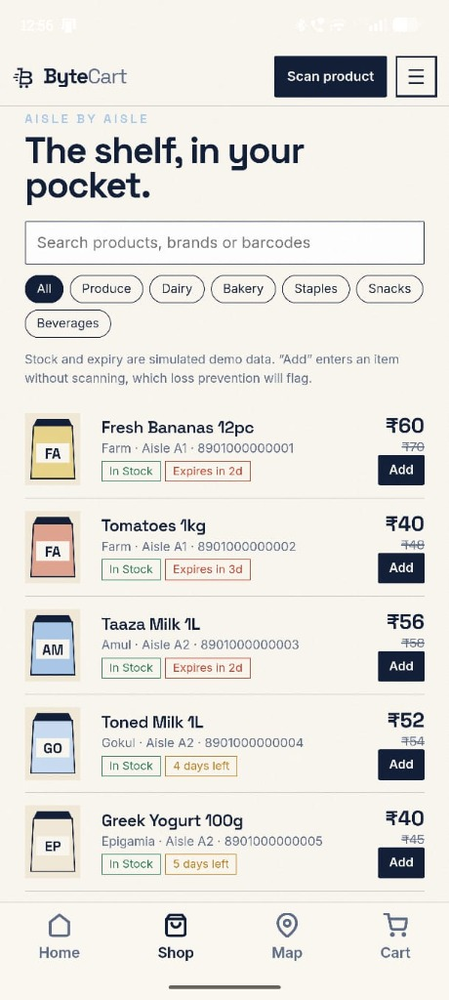
  &nbsp;
  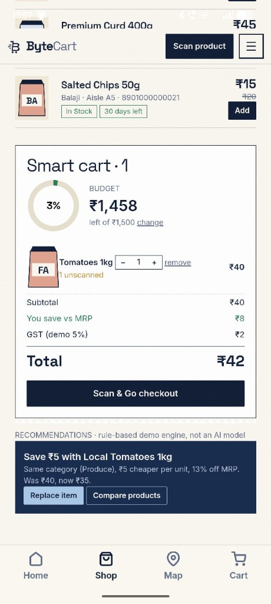
  &nbsp;
  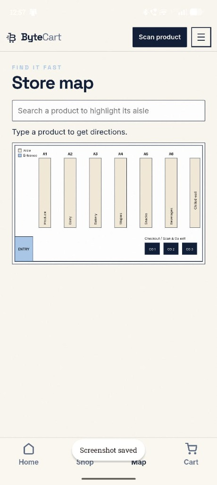
</p>

<p align="center">
  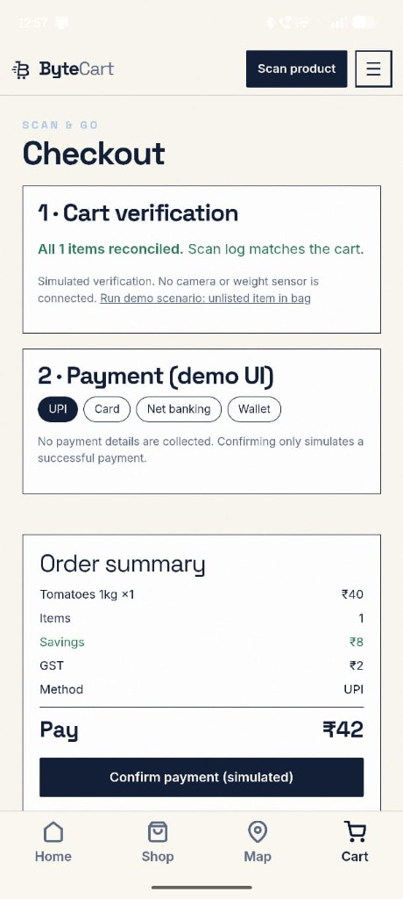
  &nbsp;
  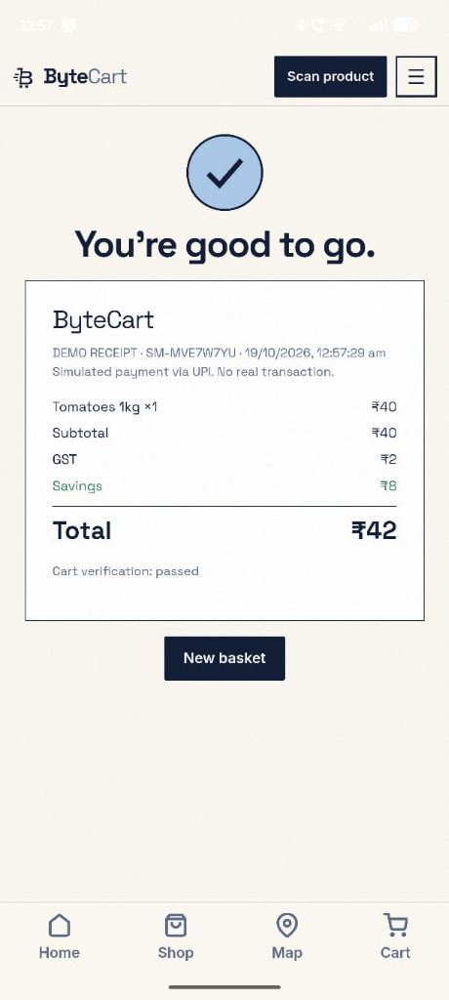
</p>

| Screen | Description |
| :--- | :--- |
| **Shop & Catalog** | Filter products by aisle (Produce, Dairy, Bakery, Snacks), monitor expiry windows, and add items directly. |
| **Smart Cart** | Live budget ring meter, item quantity controls, GST / savings calculations, and rule-based substitution recommendations. |
| **Store Map** | Visual overhead store floorplan highlighting aisles A1–A6 and exit lanes with search-to-highlight routing. |
| **Cart Verification & Checkout** | Automated item reconciliation check followed by multi-method payment selection (UPI, Card, Net Banking). |
| **Digital Receipt** | Instant order confirmation with demo receipt ID, breakdown of savings, and checkout verification clearance. |

---

## 📁 Project Structure

```text
ByteCart/
├── ByteCart android application/    # Android / Capacitor mobile application
│   ├── android/                     # Native Android project (Gradle & manifest)
│   ├── assets/                      # App assets & SVG branding
│   ├── icons/                       # Multi-density adaptive launcher icons
│   ├── capacitor.config.json        # Capacitor runtime configuration
│   └── package.json                 # Mobile dependencies and build scripts
├── ByteCart website/                # Web store frontend
│   ├── bytecart_v2.html             # Storefront entry point HTML
│   ├── bytecart_v2.css              # Custom styling & responsive design tokens
│   ├── bytecart_v2.js               # Frontend application logic & state store
│   ├── Bytecart_v2.jsx              # React / Component-based version
│   ├── icon-96.webp                 # Brand logo asset (favicon & navbar)
│   ├── logo.webp                    # Brand logo alias
│   ├── serve.js                     # Local Node.js static development server
│   └── serve_v2.py                  # Local Python preview server
├── screenshots/                     # Documentation preview images
│   ├── website-home.png             # Desktop storefront landing page
│   ├── website-shop.png             # Desktop storefront catalog & smart cart
│   ├── website-map.png              # Desktop storefront interactive floor map
│   ├── website-checkout.png         # Desktop storefront checkout & reconciliation
│   ├── website-staff.png            # Desktop staff console & inventory management
│   ├── mobile-shop.jpg              # Mobile catalog screen
│   ├── mobile-cart.jpg              # Mobile smart cart & budget screen
│   ├── mobile-map.jpg               # Mobile store map screen
│   ├── mobile-checkout.jpg          # Mobile checkout & reconciliation screen
│   └── mobile-receipt.jpg           # Mobile order confirmation receipt
└── README.md                        # Project documentation
```

---

## 🚀 Getting Started

### 1. Web Application

#### Option A: Node.js Dev Server (Recommended)
```bash
cd "ByteCart website"
node serve.js
```
The application will be accessible at **http://localhost:3000/**.

*Tip: To jump directly to specific views:*
- Storefront Home: `http://localhost:3000/#home`
- Catalog & Cart: `http://localhost:3000/#shop`
- Store Map: `http://localhost:3000/#map`
- Checkout: `http://localhost:3000/#checkout`
- Staff Console: `http://localhost:3000/#staff` (Use ID `admin` / Password `admin` or navigate with `?staff=1`)

#### Option B: Python Preview Server
```bash
python "ByteCart website/serve_v2.py"
```

#### Option C: Direct Browser Opening
Open `ByteCart website/bytecart_v2.html` directly in any modern browser.

---

### 2. Android Mobile Application

#### Prerequisites
- Node.js (v18+)
- Android Studio with Android SDK (API 33+)
- Java Development Kit (JDK 17+)

#### Installation & Build
1. Navigate into the mobile application folder:
   ```bash
   cd "ByteCart android application"
   ```

2. Install dependencies:
   ```bash
   npm install
   ```

3. Sync web assets with Capacitor:
   ```bash
   npx cap sync android
   ```

4. Open the project in Android Studio:
   ```bash
   npx cap open android
   ```
   *From Android Studio, click **Run** to launch the app on an Android device or emulator.*

---

## 🛠️ Technology Stack

- **Frontend Core**: Vanilla HTML5, CSS3 (Custom Variables, Flexbox/Grid, Glassmorphism), Vanilla ES6+ JavaScript.
- **Component Version**: React / JSX (`Bytecart_v2.jsx`).
- **Mobile Runtime**: [Capacitor](https://capacitorjs.com/) for native Android device integration.
- **Local Tooling**: Node.js HTTP server (`serve.js`), Python HTTP server (`serve_v2.py`).
- **Design System**: Space Grotesk & Inter typography, dark navigation accents, responsive mobile navigation bar.

---

## 📄 License

This project is licensed under the MIT License - feel free to use and adapt for retail tech innovation.
